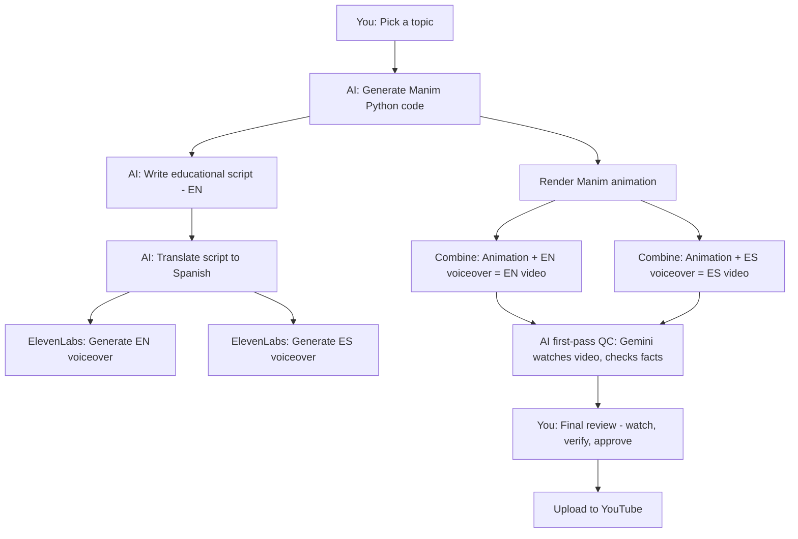

# Your Manim YouTube Channel — Complete Workflow & Blind Spots

> **Built from**: Full conversation thread, September 29, 2026
> **Reference channel**: @LearnWithManim (7K subs, 743K views, 10 videos, $14/month passive)
> **Your model**: AI-assisted educational Manim animations with ElevenLabs voiceover in English + Spanish

---

## What You Decided (Conversation Timeline)

Every decision you made, in order:

| Time | You Said | We Landed On |
|------|----------|-------------|
| 4:49 PM | "How much has LearnWithManim earned?" | ~$500-700 total from 3 videos over 6 years. $14/month now. |
| 4:55 PM | "Should I make a channel like this? No voiceover for mass audience" | **NO** — 60-70% YPP rejection risk without voice |
| 5:10 PM | "What if I add English + Spanish voiceover?" | **YES** — ~90% approval odds, doubles audience |
| 5:10 PM | "He only made 10 videos and stopped. $14/month passive is actually good" | **You're right** — I reframed. Dead channel still paying = proof the niche works |
| 5:13 PM | "I'll use ElevenLabs for voice" | **Fine** — high-quality AI voice passes review. Don't use robotic TTS |
| 5:17 PM | "AI will make the Manim code and script too" | **Fine IF you review** — you're the director, AI is the crew |
| 5:23 PM | "AI will also do the fact-checking via Gemini" | **I pushed back** — fully automated = bot channel |
| 5:24 PM | "AI + me BOTH review before uploading" | **Agreed** — two-stage QC (AI first-pass + your final review) = legitimate |

---

## Your Workflow (As I Understand It)



### Step-by-Step Detail

| Step | Who | What Happens | Tool |
|------|-----|-------------|------|
| 1. **Topic Selection** | You | Choose what concept to animate (e.g., FCC crystal structure, slip planes, Miller indices) | Your brain |
| 2. **Manim Code** | AI + You | AI generates Manim Python code for the animation. You review the code, debug, iterate until the 3D model is scientifically correct | Claude/Gemini + VS Code |
| 3. **Script Writing (EN)** | AI + You | AI writes an educational voiceover script explaining the concept. You review for accuracy and teaching quality | Claude/Gemini |
| 4. **Script Translation (ES)** | AI | AI translates the English script to Spanish | Claude/Gemini |
| 5. **Voiceover (EN)** | ElevenLabs | Generate high-quality English narration from the script | ElevenLabs v3 |
| 6. **Voiceover (ES)** | ElevenLabs | Generate high-quality Spanish narration from the translated script | ElevenLabs v3 |
| 7. **Render Animation** | Manim | Run the Manim Python code to render the animation video | Manim CE + local/cloud render |
| 8. **Combine** | FFmpeg/Editor | Sync voiceover audio with the rendered animation | FFmpeg or video editor |
| 9. **AI QC** | Gemini | AI watches the final video, checks if facts are correct, catches obvious errors | Gemini (web version watching video) |
| 10. **Your QC** | You | Watch the final video yourself, verify science, check timing, approve or reject | Your eyes and brain |
| 11. **Upload** | You | Upload to YouTube with title, description, tags, thumbnail | YouTube Studio |

---

## 14 Blind Spots You Haven't Thought About

### 🔴 Critical (Will Block Monetization or Kill Growth)

#### 1. One Channel or Two? — You Haven't Decided

You said "English + Spanish." But you never said whether that's:

- **Option A: One channel, both languages** — TERRIBLE for the algorithm. YouTube recommends your videos to people who watched your previous videos. If a Spanish viewer gets recommended an English video, they bounce. Your retention tanks. The algorithm stops recommending you.
- **Option B: Two separate channels** — Better for the algorithm, but double the work to reach 1,000 subs + 4,000 watch hours on EACH channel. You need to hit YPP thresholds twice.
- **Option C: One channel, English only. Spanish as a second channel later** — Best strategy. Build ONE channel to monetization first. Then duplicate to Spanish once you have a working system.

> [!IMPORTANT]
> **Recommendation: Start English only.** Get monetized. Then launch a Spanish channel using the same videos with swapped audio. Don't split your effort before you've proven the model works.

#### 2. Your Videos Are Too Short for Mid-Roll Ads

LearnWithManim's videos are 3:30-4:00 minutes. **YouTube requires 8+ minutes for mid-roll ads.** Mid-rolls are where the real money is — they can 2-3x your RPM.

At 3-4 minutes, you only get a pre-roll ad. That's $1-2 RPM territory.

At 8-12 minutes with 1-2 mid-rolls, you're looking at $3-6 RPM.

| Video Length | Ad Slots | Estimated RPM |
|-------------|----------|---------------|
| 3-4 min | Pre-roll only | $1.50-2.00 |
| 8-10 min | Pre-roll + 1 mid-roll | $3.00-5.00 |
| 12-15 min | Pre-roll + 2 mid-rolls | $4.00-7.00 |

> [!IMPORTANT]
> **Make your videos 8-12 minutes.** Cover multiple related concepts in one video. "Crystal Structures: BCC vs FCC vs HCP — Complete Comparison" (10 min) earns 3x what three separate 3-min videos earn.

#### 3. Monetization Timeline Math — It's Slower Than You Think

YouTube Partner Program requires: **1,000 subscribers + 4,000 watch hours (240,000 minutes)**

With 8-minute videos:
- 240,000 minutes ÷ 8 min/video = 30,000 full views needed
- If your average video gets 5,000 views in the first 6 months → you need ~6 videos with full watch-through
- But average view duration is usually 40-50% of video length → you need ~60,000-75,000 total views
- At LearnWithManim's pace (10 videos, 743K views over 6 years), this could take 6-12 months

> [!WARNING]
> **Don't expect monetization before month 6-9.** Budget accordingly. This is not quick money.

#### 4. The "Reviewer Sees Your Whole Catalog" Problem

When you apply for YPP, a human reviewer watches several of your videos. If they open 5 videos and ALL of them are:
- Same Manim visual style
- Same ElevenLabs voice
- Same 3D crystal structure topic
- Same format (intro → concept → math → outro)

They might flag it as "templated" even with voiceover. You need **visible variety** across your catalog.

**Fix:** Mix your topics. Don't make 10 crystal structure videos in a row. Alternate: crystal structure → mechanical properties → phase diagrams → stress-strain → crystal again. Show range.

---

### 🟡 Important (Will Limit Growth or Revenue)

#### 5. Topic Exhaustion — Crystal Structures Run Out

Material science crystal structures have maybe 15-25 solid video topics:
- SC, BCC, FCC, HCP (done by LearnWithManim)
- Diamond cubic, Zinc blende, Wurtzite, Perovskite
- Miller indices, slip planes, Burgers vector
- Vacancies, interstitials, Frenkel/Schottky defects
- Phase diagrams, iron-carbon diagram

After 25 videos, you need to expand or you're making "Crystal Structure #26" which nobody searches for.

**Fix:** Plan your topic roadmap NOW. Map out 50+ topics across material science, solid state physics, crystallography, and mechanical engineering. Consider expanding to other STEM fields that use 3D visualization (organic chemistry molecules, electromagnetic fields, fluid dynamics).

#### 6. Spanish Script Accuracy — Who Checks It?

AI translates English → Spanish. But:
- Scientific terminology in Spanish is different (e.g., "packing factor" = "factor de empaquetamiento")
- AI might use Spain-Spanish vs Latin American-Spanish (different audiences)
- A wrong technical term in Spanish won't be caught by your review (do you speak Spanish?)
- Gemini watching the video won't catch translation nuance either

**Fix:** If you launch a Spanish channel, pay a native Spanish-speaking engineering student $5-10/video to proofread the script. It's cheap insurance against publishing nonsense to an audience you can't understand.

#### 7. Thumbnails — Not Mentioned Once

You haven't talked about thumbnails at all. For educational search-driven content:
- The thumbnail needs to show what concept the video covers
- Text on thumbnail should be large and readable on mobile
- 3D renders from Manim can BE the thumbnail (but need to be eye-catching, not just a screenshot)
- Consistent branding across thumbnails builds channel recognition

**Fix:** Design a thumbnail template: bold text overlay + key Manim render + consistent color scheme. Generate these programmatically or use AI image generation.

#### 8. SEO — Your Videos Live or Die by Search

LearnWithManim gets 82% of its traffic from search (evidenced by the high outlier score on specific queries like "hexagonal close packed crystal structure"). Your channel will be the same — nobody is browsing YouTube for crystal structure content, they're searching for it.

What you need for every video:
- **Title**: Exact search phrase people type (e.g., "Face Centered Cubic Crystal Structure — FCC Unit Cell Explained")
- **Description**: 200+ words with related terms, timestamps, links to related videos
- **Tags**: All relevant search terms
- **Chapters**: Timestamp markers so Google shows specific sections in search results

> You haven't mentioned ANY of this. It's how you get found.

#### 9. Music & Sound Design

Voiceover alone sounds flat. You need:
- Background music (low volume, ambient/educational style) during narration
- Sound effects for transitions (whoosh, click, build-up)
- Silence management (pauses between sections shouldn't be dead air)

LearnWithManim uses "Going Higher" from Bensound. You need a consistent audio identity.

**Fix:** Pick 2-3 royalty-free background tracks. Use them consistently. ElevenLabs audio + background music + transition sounds = professional feel.

---

### 🟢 Nice to Have (Growth Multipliers)

#### 10. Audience Retention Techniques

Even with voiceover, educational videos bleed viewers. Techniques that work:
- **Hook in first 5 seconds**: "You've probably seen this crystal structure in every textbook — but here's what they never show you"
- **Pattern interrupts every 60-90 seconds**: Change camera angle, zoom in, show a different visualization, ask a rhetorical question
- **Open loops**: "We'll see WHY the packing factor matters when we get to mechanical properties"
- **End screen with next video**: "Now that you understand FCC, the next structure you need to know is HCP — watch that here"

#### 11. Content Calendar & Upload Consistency

You haven't set a schedule. YouTube rewards consistency.

**Recommendation:**
- **Phase 1 (Month 1-3):** 2 videos/week, build catalog to 20-25 videos fast
- **Phase 2 (Month 4-6):** 1 video/week, maintain momentum while building Spanish versions
- **Phase 3 (Month 7+):** 1 video/week EN + 1 video/week ES (if Spanish channel launches)

#### 12. Manim Rendering Infrastructure

Rendering Manim animations takes real compute time, especially 3D scenes. You haven't decided:
- Local machine? (slow, ties up your computer)
- GitHub Actions render farm? (you have the manim-render-farm skill installed)
- Cloud render? (costs money)

**Recommendation:** Use the GitHub Actions Manim render farm for batch rendering. You already have the skill set up.

#### 13. Channel Differentiation from LearnWithManim

Your channel is the same niche, same tool, same topic area. What makes you different?
- LearnWithManim: no voice, pure visual, 3-4 min
- **Your channel should be:** voiceover narration, 8-12 min, deeper explanations, multiple concepts per video, better production quality

Make sure your channel doesn't look like a LearnWithManim clone.

#### 14. Community Building

Educational channels grow through:
- Replying to comments (especially questions — these boost engagement signals)
- Pinned comments with corrections or additional resources
- Community tab posts (polls: "What should I animate next?")
- End-of-video CTAs ("Comment which crystal structure you want explained next")

None of this is automated. This is where YOUR human presence shows.

---

## The Complete Pipeline (What You Should Build)

```
┌─────────────────────────────────────────────────────────────┐
│                    WEEKLY PRODUCTION CYCLE                    │
├─────────────────────────────────────────────────────────────┤
│                                                             │
│  DAY 1: PLANNING                                           │
│  ├── Pick topic from your 50+ topic roadmap                │
│  ├── Research: what does the audience search for?           │
│  ├── Define: title, key concepts, video structure           │
│  └── Write brief for AI: "Explain X, cover Y and Z"        │
│                                                             │
│  DAY 2: GENERATION                                         │
│  ├── AI generates Manim Python code                        │
│  ├── AI writes voiceover script (EN)                       │
│  ├── You review code + script for accuracy                 │
│  ├── Iterate until correct                                 │
│  └── Submit Manim render (GitHub Actions or local)         │
│                                                             │
│  DAY 3: PRODUCTION                                         │
│  ├── ElevenLabs: generate EN voiceover                     │
│  ├── Combine animation + voiceover + music                 │
│  ├── Add intro/outro, transitions, text overlays           │
│  └── Export final video                                    │
│                                                             │
│  DAY 4: QC + UPLOAD                                        │
│  ├── AI first-pass: Gemini watches video, checks facts     │
│  ├── You: watch full video, final approval                 │
│  ├── Create thumbnail                                      │
│  ├── Write title, description, tags, chapters              │
│  └── Upload + schedule publish                             │
│                                                             │
│  DAY 5-7: ENGAGEMENT                                       │
│  ├── Reply to comments                                     │
│  ├── Post community tab content                            │
│  └── Start planning next week's video                      │
│                                                             │
└─────────────────────────────────────────────────────────────┘
```

---

## Summary: What You Have vs What You're Missing

| Aspect | You've Decided ✅ | Blind Spot ❌ |
|--------|-------------------|-------------|
| Niche | Material science / crystal structures | Topic exhaustion after ~25 videos |
| Language | English + Spanish | One channel or two? (Start with one, EN only) |
| Voice | ElevenLabs AI voice | Vary voice settings between videos |
| Animation | Manim, AI-generated code | Rendering infrastructure |
| Script | AI-written, you review | Spanish accuracy — who checks? |
| QC | AI + human review | ✅ Solved |
| Video length | Not discussed | **Must be 8+ minutes for mid-roll ads** |
| Thumbnails | Not discussed | Need a system |
| SEO | Not discussed | Title/description/tags/chapters strategy |
| Music | Not discussed | Background tracks + sound design |
| Upload schedule | Not discussed | 2/week initially, 1/week sustained |
| Monetization timeline | Not discussed | 6-9 months minimum |
| Retention techniques | Not discussed | Hooks, pattern interrupts, open loops |
| Community | Not discussed | Comment replies, community tab |
| Differentiation | Not discussed | What makes you different from LearnWithManim? |
